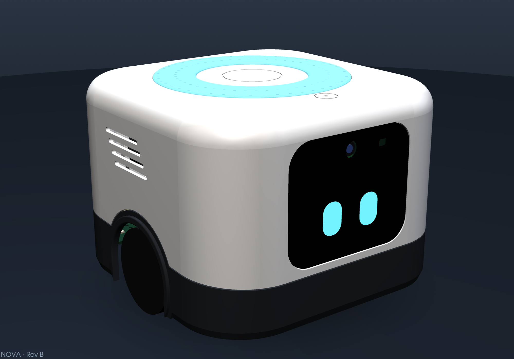
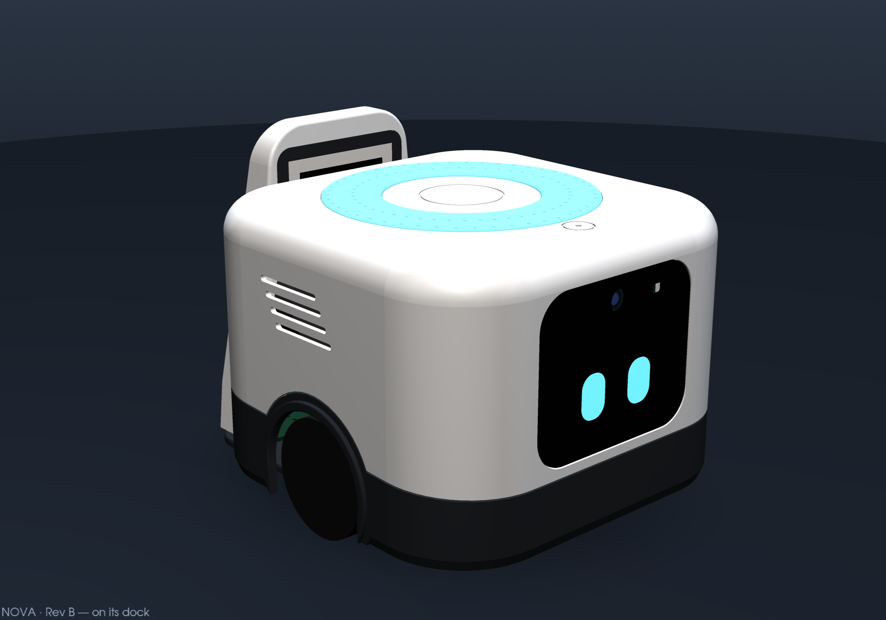
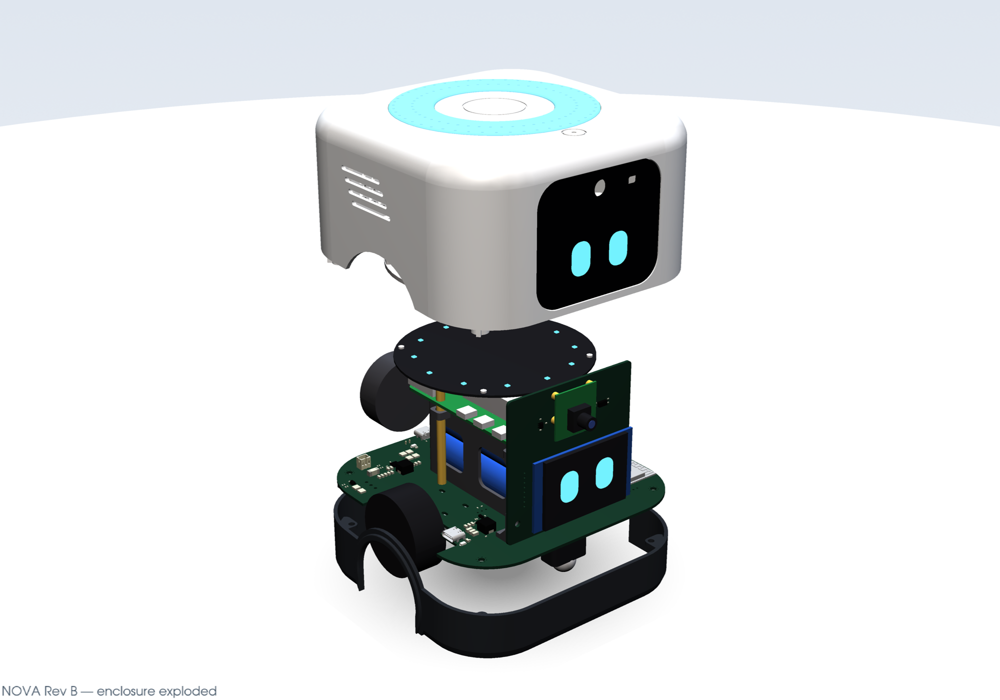
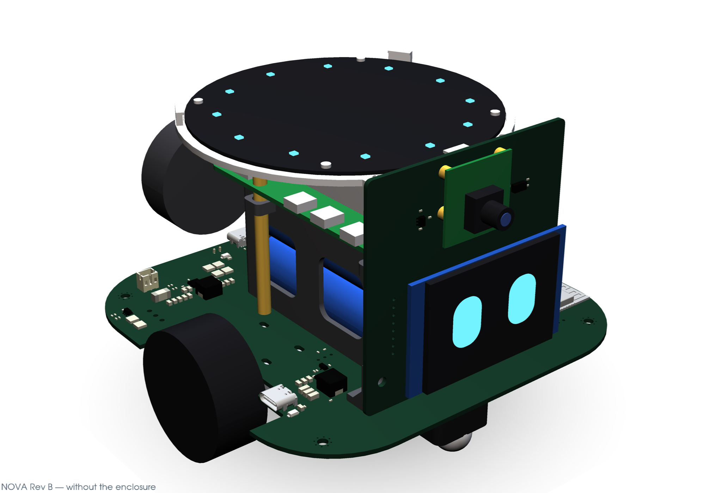
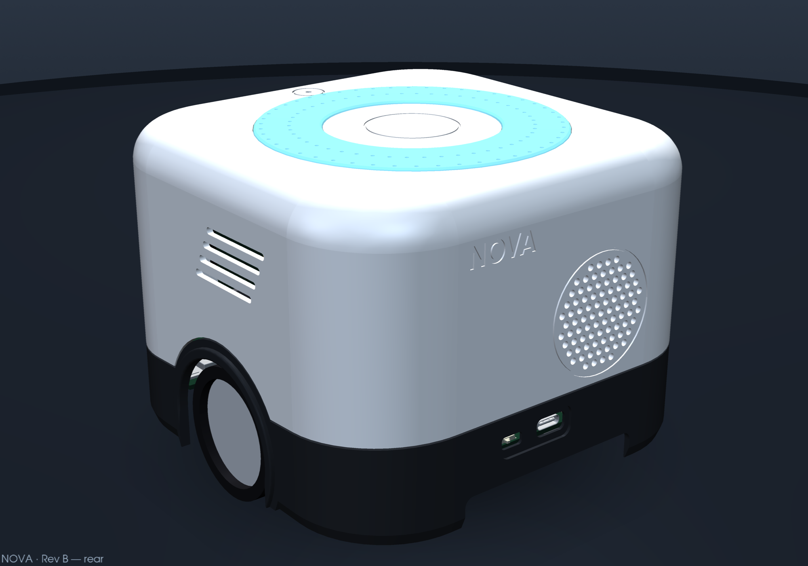
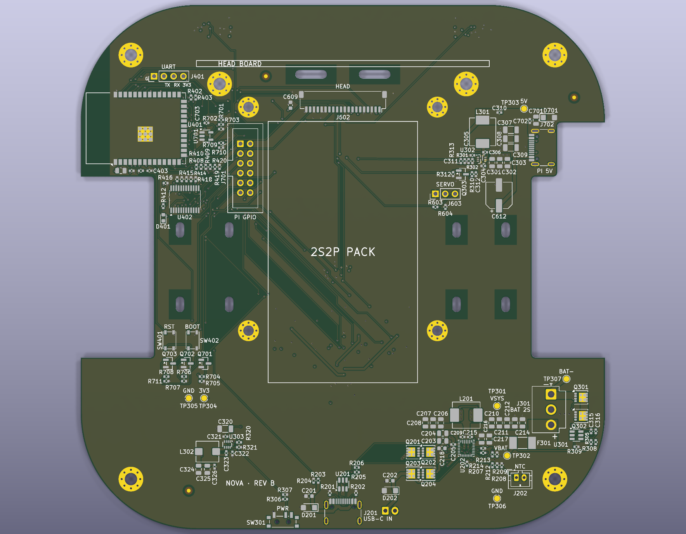
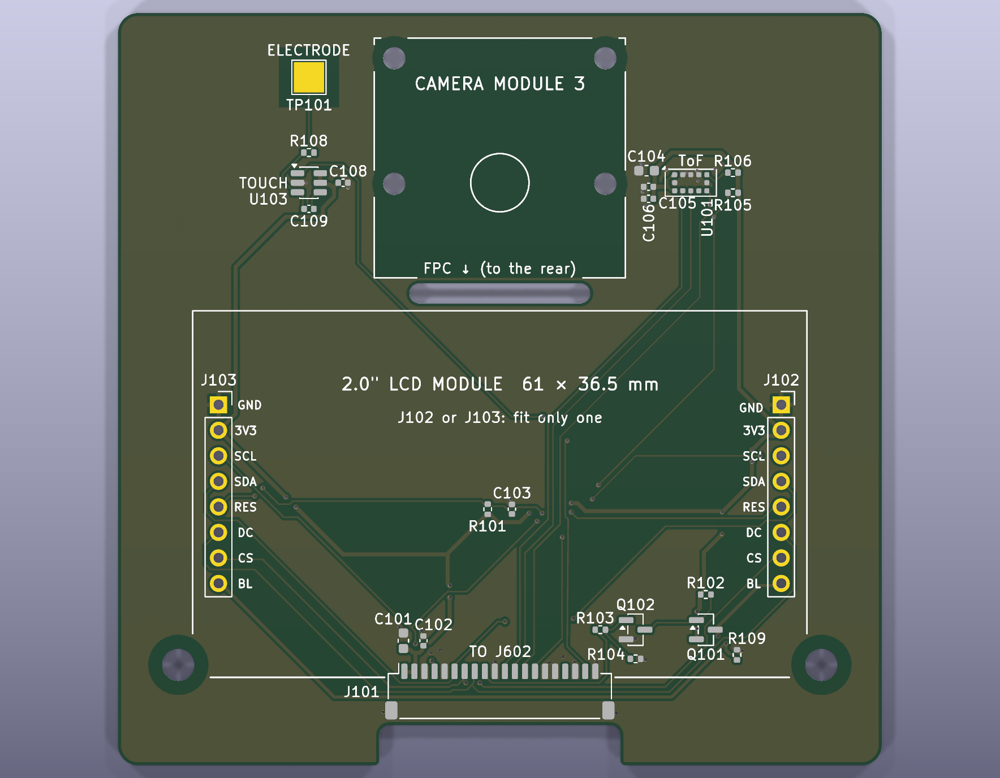
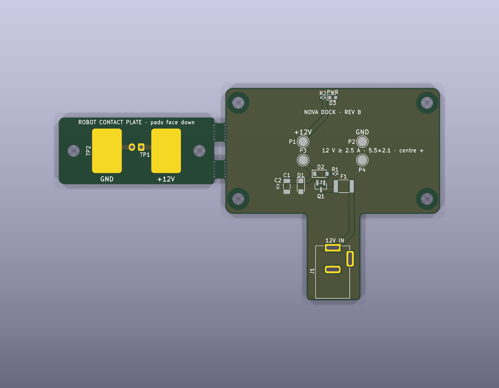
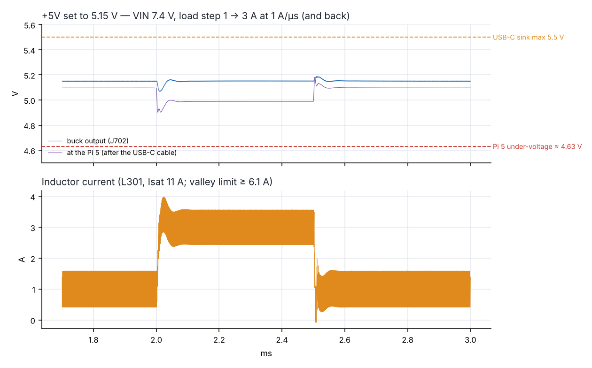

# NOVA — a small desktop robot with a Raspberry Pi 5 brain

<p align="center"></p>

NOVA is a palm-sized home robot designed end to end: electronics, PCBs, enclosure, charging dock, simulations and
documentation. A Raspberry Pi 5 does vision, voice and the link to cloud AI models. An ESP32-S3 keeps the body alive:
motors, sensors, display face and power. The robot drives back to a 12 V dock by itself to charge.

> **Status:** Rev B design complete and verified (ERC/DRC clean, mechanical interference check, circuit and system
> simulations). The physical prototype has not been built yet.

| | |
|---|---|
|  |  |
| On its charging dock (AprilTag for the return trip) | Five-part enclosure: white body, graphite skirt, smoked visor, light halo |
|  |  |
| Internals: main board, 2S2P pack, Pi 5, XVF3800 mic array, head board | Rear: speaker grille, USB-C, power switch, dock opening |

## What is inside

| Block | Parts |
|---|---|
| Brain | Raspberry Pi 5 + Active Cooler, Camera Module 3, ReSpeaker XVF3800 4-mic array with echo cancellation |
| Body controller | ESP32-S3-WROOM-1 (N16R8), TCA9535 I/O expander, LSM6DSOX IMU |
| Drive | 2 × N20 gear motors with Hall encoders, TB6612FNG, ball caster |
| Sensors | 2 × VL53L4CD cliff ToF, VL53L1X front ToF, AT42QT1010 capacitive touch |
| Face | 2.0" ST7789 IPS display behind a smoked acrylic visor |
| Power | 2S2P 18650 (44 Wh), R5460 protector, TI BQ25798 buck-boost NVDC charger with two inputs (USB-C and 12 V dock), TPS566238 6 A for the Pi 5, TPS62933 for 3.3 V |
| Dock | 12 V input with PTC, reverse-polarity FET and TVS, spring pogo contacts, AprilTag target |
| Pi ↔ ESP32 | UART0 (the Pi can re-flash the ESP32 through its ROM bootloader), shutdown/reset/boot lines |

Cloud AI: the hardware is laid out so that the Pi 5 runs the voice pipeline (wake word and audio from the XVF3800)
and calls hosted LLM, speech and vision APIs over Wi-Fi, while light models (wake word, AprilTag, small vision models)
run on the device. The firmware and software are the next step.

## Boards (KiCad 10)

| Board | Layers | Size | Verification |
|---|---|---|---|
| `nova-main` | 4 | 136 × 136 mm | ERC 0 (3 documented exclusions), DRC 0, 0 unconnected, schematic parity 0 |
| `nova-head` | 2 | 76 × 74.9 mm | ERC 0, DRC 0, 0 unconnected, parity 0 |
| `nova-dock` | 2 | 58 × 34 mm + break-away contact plate | ERC 0, DRC 0, 0 unconnected, parity 0 |

| | | |
|---|---|---|
|  |  |  |
| Main board | Head board | Dock board |

Each board has JLCPCB-ready Gerbers, BOM and CPL files, a full BOM with Mouser/DigiKey codes, assembly drawings,
a 1:1 mechanical drawing and STEP in `hardware/<board>/fabrication/`.

## Simulations

Circuit simulations in ngspice and system analyses in Python. Full report:
[simulations/NOVA_RevB_simulations.pdf](simulations/NOVA_RevB_simulations.pdf).

| Check | Result |
|---|---|
| Pi 5 rail, 1 → 3 A load step (behavioural D-CAP3 model) | ≥ 4.90 V at the Pi (under-voltage at 4.63 V), 3.9 mV ripple |
| VSYS with both motors under PWM | 46 mV p-p driving, 108 mV p-p with both motors stalled |
| Dock and USB-C hot plug, reverse polarity | ≤ 19.5 V at the charger input (30 V max), reversed adapter blocked |
| I2C and display SPI edges | 207 ns rise time (≤ 300 ns), SPI ringing removed with a lower drive strength |
| Runtime (44 Wh) | 10 h idle, 6.9 h in conversation, 4.3 h at full load, 11 days standby |
| Docking (Monte Carlo) | 99 % first-try success with the recommended approach procedure |
| Stability, thermal, pogo-contact current, battery protection | see the report |

<p align="center"></p>

## Repository layout

```
docs/          design document (MD + PDF), images, verification summary
hardware/      KiCad 10 projects: nova-main, nova-head, nova-dock, project library (lib/), fabrication outputs
mechanics/     CadQuery enclosure and assembly (Python), renders, printed parts (STEP + STL), assembly STEP
generator/     Python generators for the schematics, footprints, PCB placement/routing and the documentation
simulations/   ngspice and Python models, netlists, plots, results and the simulation report
```

The schematics and boards are generated by the scripts in `generator/` (including an in-house PathFinder-style
router); the enclosure is parametric CadQuery code driven by `mechanics/dims.py`. The scripts were written for the
author's build environment (KiCad 10.0.7 built from source, absolute paths), so treat them as reference.

## Tools

KiCad 10 · ngspice 42 · CadQuery / OpenCascade · Python (numpy, matplotlib, pyvista)

## Author and licence

Designed by **Caril Ronnie Martínez Vera** — electronics and telecommunications engineer.
© 2026, all rights reserved: see [LICENSE](LICENSE). The files are published for viewing only.
