# NOVA — Rev B: simulations and system analyses

Date: 2026-10-29 · ngspice 42 (batch) · Python 3 (numpy) · CadQuery mass properties · ronmart · Caril Ronnie Martínez Vera

Everything in Rev B that can be checked without hardware was simulated: power rails, transients at the connectors,
signal edges, and the robot as a system (stability, drive, energy, charging, heat, docking). Every model lists its
inputs and their source in the scripts (`sim/spice_sims.py`, `sim/system_sims.py`, `sim/mass_props.py`): datasheet values
where they exist, CAD for geometry and masses of printed parts, and marked estimates (“est.”) for the rest.

## 1. Summary

| # | Check | Result | Limit | Verdict |
|---|---|---|---|---|
| S1 | VSYS ripple, both motors PWM + Pi 3 A | 46 mV p-p driving, 108 mV at stall; min 6.30 V at 6.6 V battery | TPS566238 / TPS62933 inputs ≥ 3 V | OK |
| S2 | +5V (Pi 5) load step 1 → 3 A | min 4.90 V at the Pi, 4.99 V steady at 3 A; ripple 3.9 mV p-p | Pi 5 under-voltage ≈ 4.63 V | OK (270 mV margin) |
| S2 | +5V extreme step 0.5 → 5 A, 2 A/µs, battery 6.6 V | min 4.62 V for ≈ 10 µs; 4.88 V steady; overshoot 5.22 V; L301 peak 6.6 A | 4.63 V; Isat 11 A; valley limit ≥ 6.1 A | Marginal (option: 5.22 V) |
| S3 | +3V3 step 0.1 → 0.6 A | 3.29 … 3.35 V, ripple 2.1 mV | 3.0–3.6 V | OK |
| S4 | Power-up sequence | +3V3 at 5.8 ms, +5V at 4.9 ms, ESP32 EN at 17.4 ms | EN after the supply is stable | OK |
| S5 | Dock: adapter plug-in / robot docks on a live dock / reversed adapter | VAC2 peak 16.5 V / 19.5 V / blocked (0 V) | VAC2 abs. max 30 V | OK |
| S6 | USB-C hot plug | VBUS peak 8.5 V (U201 clamps 0.84 A); VBUS_DET 4.74 V | BQ25798 30 V; TCA9535 6 V | OK (option: RC damper → 6.2 V) |
| S7 | I2C rise time (2.2 kΩ, 111 pF estimated from the layout) | 207 ns; 310 ns at +50 % C | ≤ 300 ns (400 kHz) | OK, measure at bring-up |
| S8 | Display SCLK 40 MHz over the head cable | 3.79 V / -0.49 V (drive 2); 3.30 / 0.00 V (drive 1) | ±0.3 V beyond the rails | Firmware: drive strength 1 |
| A | Static stability (CAD mass 750 g) | CoG 3.3 mm ahead of the axle at 56 mm height → tips back at 0.58 m/s² | — | **Action** |
| B | Drive (N20 6 V, Ø43 wheels) | 1:100 → 0.34 m/s, stall force 11.5 N (≫ tip limit) | TB6612 1.2 A cont. | OK with acceleration limit |
| C | Runtime (44 Wh) | idle 10.1 h · conversation 6.9 h · vision + drive 4.9 h · full 4.3 h · standby 11 days | — | — |
| D | Charging 10 → 80 % | dock 2.5 A: 1.5 h · dock 1.8 A: 2.2 h · USB-C 5 V 3 A: 4.0 h (Pi idle) | — | USB-C is a backup input |
| E | Pogo-pin current sharing | at 2.5 A: P(one pin > 1.5 A) = 76 %; at 1.8 A: 0 % | 1.5 A per pin (datasheet) | **Action: IINDPM ≤ 1.8 A** |
| F | Battery protector / fuse | worst load 6.0 A, realistic 4.2 A vs. trip ≥ 6.4 A (12 ms) | fuse 10 A | OK |
| G | Thermal (Pi 5 SoC inside the shell, 25 °C room) | conversation 60 °C · full load 82 °C | soft throttling 80 °C | Marginal at sustained full load |
| H | Docking first-try success | as written in the design: 46 % · recommended procedure: 99 % | capture ±6.5 mm | **Action: procedure** |
| I | AprilTag (40 mm) range, 1536 px stream | detection ≈ 2.0 m, good pose ≤ 0.74 m, closest 0.10 m | — | OK |

### Findings that need a decision

The design files were not changed, except the pogo-pin text in the dock BOM (finding 2).

1. **Tip-back margin is small (A).** The centre of gravity is only 3.3 mm in front of the wheel axle
   (5–95 % range with the mass estimates: 1.7–4.9 mm) and 56 mm high. The
   caster carries ≈ 50 g. Any acceleration above **0.58 m/s²** forwards (or braking
   while reversing onto the dock) lifts the caster and rocks the robot back 6.6° onto the rear skirt; a
   0.6 N push on the rear of the top does the same. Options: (a) firmware only — limit acceleration and
   braking to ≤ 0.4 m/s² with a jerk-limited ramp (enough for a desk robot: 0.25 m/s in 0.6 s); (b) **100 g of ballast**
   under the front of the main board (next to the caster) → CoG 9.8 mm, limit
   1.87 m/s²; (c) two small rear glides on the skirt at |X| ≈ 55 mm (outside the dock base),
   1–1.5 mm above the floor, which cap the rock at ≈ 1.4°. Recommended: (a) always, plus (b) or (c). Check at the first
   assembly by weighing the caster load (≈ 50 g expected).
2. **Pogo pins (E).** The YTC1P-8020 datasheet gives 1.5 A max and ≤ 100 mΩ per pin. With two pins per polarity and
   2.5 A, unequal contact resistance puts more than 1.5 A on one pin in 76 % of the cases (worst
   2.08 A). **Set the BQ25798 VAC2 input current limit to 1.8 A** (worst 1.50 A per
   pin): dock charging 10 → 80 % takes 2.2 h with the Pi idle
   (1.7 h with the Pi off) instead of 1.5 h.
   A hardware alternative for a later revision: three pins per polarity or 3 A pins. The BOM description of the pogo pins
   was corrected to 1.5 A / 100 mΩ.
3. **Docking procedure (H).** “See the tag, turn 180°, reverse” from 0.40 m succeeds at the first try in
   46 % of the runs (σ 11 mm at the opening): the heading error is multiplied by the
   reverse distance. Recommended procedure: track the tag until the camera is 0.12 m from it, drive on to a turn point
   134 mm from the dock wall (the closest point where the shell clears the tongue while turning), turn 180° with the gyro,
   reverse 62 mm until VAC2 is detected. First try 99 %; without gyro scale and camera-yaw calibration
   82 %. Retry automatically when VAC2 is not detected (three tries: > 99.9 %). A larger tongue chamfer
   (8 mm) alone only brings the 0.40 m procedure to 65 %.
4. **Heat at sustained full load (G).** With ≈ 7.5 W on the Pi 5 (all cores busy, camera on) the SoC reaches
   ≈ 82 °C in a 25 °C room (soft throttling starts at 80 °C) because the air inside the shell
   sits ≈ 16 K above the room. Conversation with a cloud AI (≈ 4.5 W) stays at
   ≈ 60 °C. Doubling the gills and adding a low inlet gains only ≈
   5 K, since most of the rise is the
   Active Cooler itself. Practical rule: heavy AI in the cloud, or accept throttling during long local inference. Docked
   and charging in a 35 °C room the air inside reaches ≈ 46 °C: the
   BQ25798 JEITA “warm” range will reduce the charge (NTC on TS).
5. **Pi 5 rail at extreme load (S2).** At a realistic 1 → 3 A step the Pi sees ≥ 4.90 V. Only a
   0.5 → 5 A step at 2 A/µs with a nearly empty battery touches the 4.63 V warning level (4.62 V for
   ≈ 10 µs, mostly the USB-C cable's inductance). Optional: R301 182 k → 187 k and R302 24 k → 24.3 k sets 5.22 V
   (4.68 V minimum, 4.95 V steady at 5 A, overshoot 5.31 V < 5.5 V).
6. **USB-C charging (D).** The BQ25798 reads only D+/D− (BC1.2), not the Type-C CC advertisement; a DCP sets 3.25 A
   with VINDPM protecting the source. From a 5 V 3 A charger the robot charges in 5.4 h with the
   Pi idle; from a 1.5 A source only 0.31 A reach the battery. The dock is the main
   charging path; firmware: VINDPM ≈ 4.5 V and ICO enabled for USB-C.
7. **Firmware settings that come out of the simulations:** ESP32-S3 drive strength 1 on GPIO11/12 (S8); acceleration
   limit (A/B); VAC2 IINDPM 1.8 A (E); motor PWM limited to a 6 V average (B); docking procedure and retries (H).

## 2. Circuit simulations (ngspice)

### S1 — VSYS with the motors under PWM
TB6612 (≈ 0.5 Ω per switch), both N20 channels in phase at 20 kHz / 75 % (worst case), motor 9 Ω / 0.6 mH, start from
standstill at 2 ms; Pi 5 buck input as 3 A pulses at 600 kHz; 3.3 V buck 0.25 A. Battery 2S2P ≈ 90 mΩ + 0.3 µH;
VSYS bank 72 µF ceramic (derated) + 100 µF electrolytic.
Result: 46 mV p-p while driving, 108 mV p-p with both motors stalled,
battery current 2.5 A / 3.1 A.

<figure>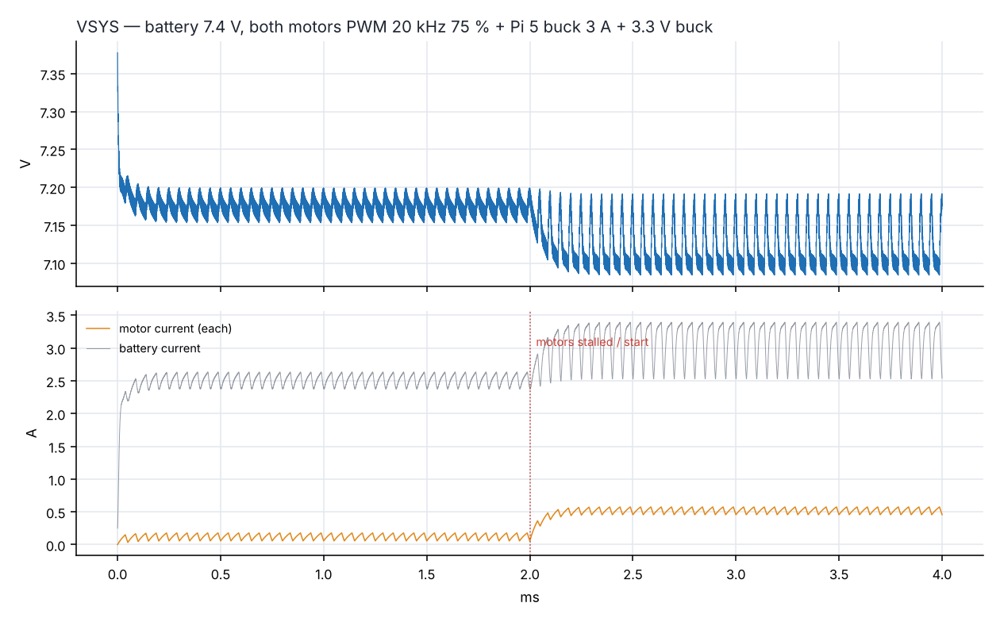<figcaption>S1 — battery 7.4 V</figcaption></figure>

### S2 — +5V rail for the Pi 5 (TPS566238, behavioural D-CAP3 model)
Constant-on-time model (on-time Vout/(Vin·fsw), 100 ns minimum off-time, Rds(on) 20.8/10.6 mΩ, VFB 0.6 V), validated
at 5150 mV DC, ≈ 600 kHz and 3.9 mV p-p ripple. Load: USB-C cable to the Pi
(2 × 25 mΩ, 0.15 µH) and ≈ 20 µF at the Pi input. Cases: a) 7.4 V, 1 → 3 A at 1 A/µs; b) same at 6.6 V; c/d) 0.5 → 5 A at
2 A/µs at 8.4 V / 6.6 V; e) case d with the output set to 5.22 V.

| Case | Vout min / max | Pi min | Pi steady (high load) | L301 peak |
|---|---|---|---|---|
| a | 5.07 / 5.19 V | 4.90 V | 4.99 V | 4.0 A |
| b | 5.07 / 5.20 V | 4.90 V | 4.99 V | 3.8 A |
| c | 5.00 / 5.20 V | 4.69 V | 4.88 V | 6.5 A |
| d | 4.91 / 5.22 V | 4.62 V | 4.88 V | 6.6 A |
| e | 4.97 / 5.31 V | 4.68 V | 4.95 V | 6.9 A |

<figure>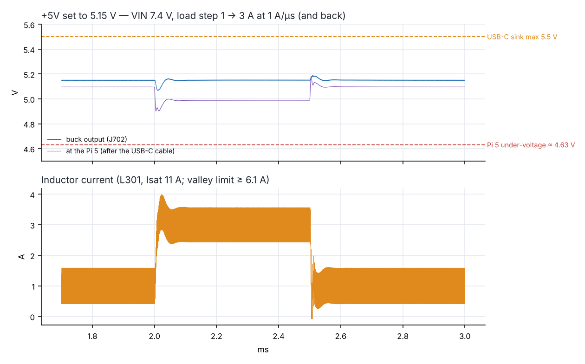<figcaption>S2a — realistic Pi 5 load step</figcaption></figure>

<figure>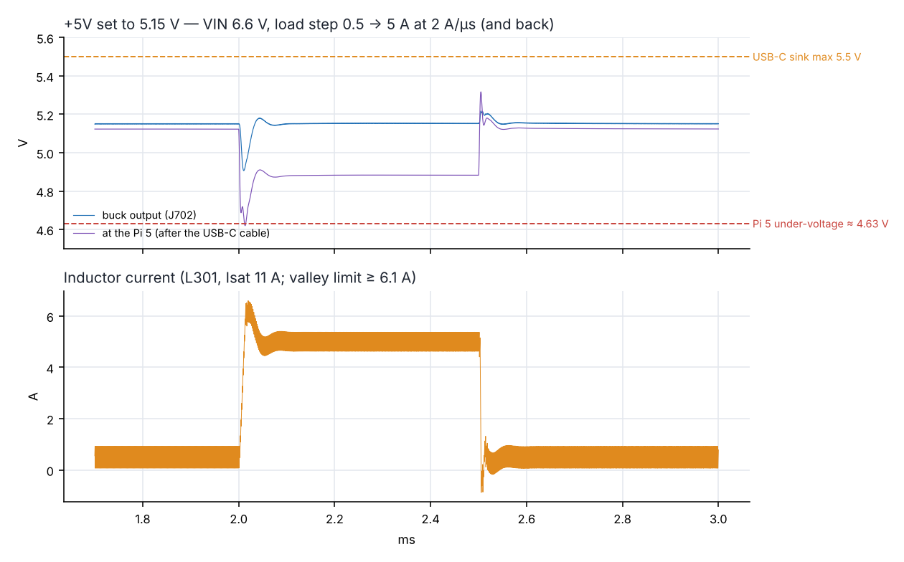<figcaption>S2d — extreme step at a low battery</figcaption></figure>

<figure>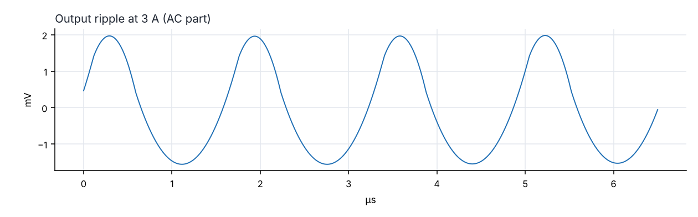<figcaption>S2 — output ripple at 3 A</figcaption></figure>

### S3 — +3V3 always-on rail (TPS62933)
The TPS62933 is peak-current-mode; the COT model at 1.2 MHz gives ripple and the size of the response to a
0.1 → 0.6 A step (Wi-Fi burst + backlight): 3.29–3.35 V, 2.1 mV p-p.

<figure>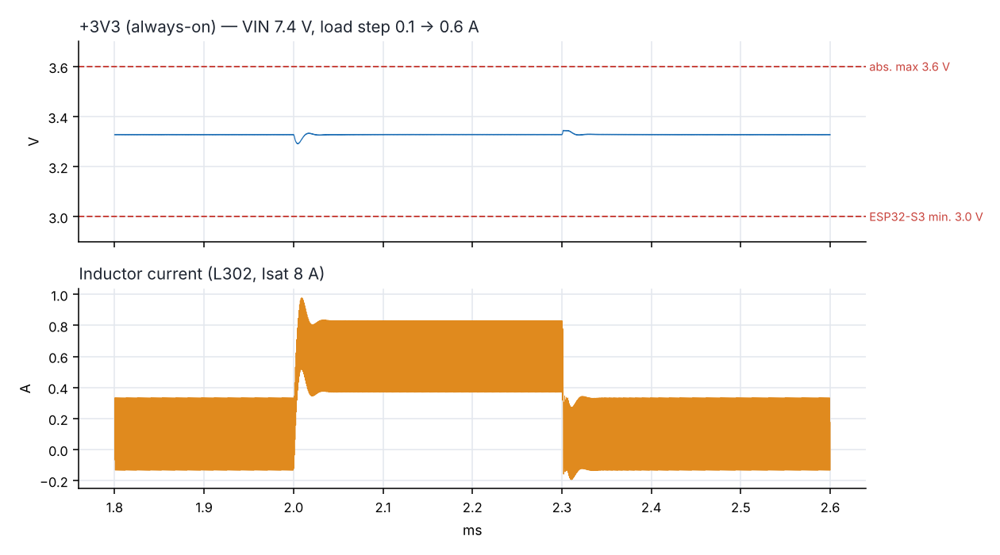<figcaption>S3 — +3V3 load step</figcaption></figure>

### S4 — power-up sequence
Switch on at 1 ms → TPS62933 soft start (Css 33 nF ≈ 4.8 ms) → PI_EN (R310 100 k from +3V3) crosses the EN
threshold at 3.1 ms → +5V soft start 1.9 ms (in regulation at 4.9 ms) → ESP32 CHIP_PU
(10 k / 1 µF) reaches 0.75 × VDD at 17.4 ms, ≈ 11 ms after +3V3 is stable.

<figure>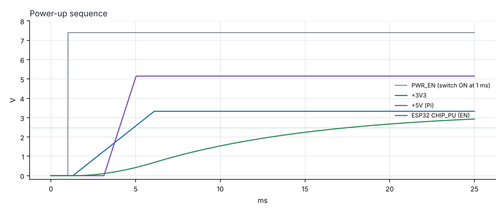<figcaption>S4 — sequence</figcaption></figure>

### S5 — dock transients
12 V adapter with 1.5 m cable → PTC → AO3401A reverse-polarity FET → 10 µF + SMF15A → pogo pins → robot lead →
C202 1 µF + SMF15A → VAC2. Plugging the adapter in gives 16.5 V at VAC2; docking on a live dock rings to
19.5 V (clamped by D202, 2.1 A peak) with a 34 A sub-µs inrush
into C202 (12 µC, below the 50 µC that USB allows for a hot plug); a reversed adapter is blocked by Q1.

<figure>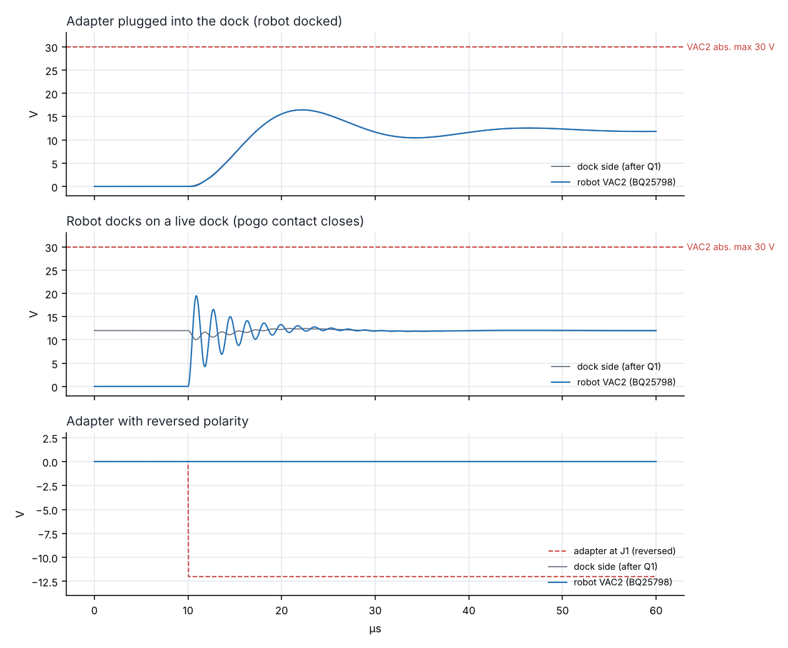<figcaption>S5 — dock cases</figcaption></figure>

### S6 — USB-C hot plug
1 m cable (0.12 Ω, 0.8 µH) into C201 1 µF: the LC rings to 9.0 V; U201's VBUS zener (≥ 6 V)
limits it to 8.5 V and conducts 0.84 A for ≈ 1 µs. VBUS_DET peaks at
4.74 V (TCA9535 abs. max 6 V, inputs 5 V tolerant). Option for a later revision: 1 Ω + 4.7 µF
damper at J201 → 6.2 V and no zener current.

<figure>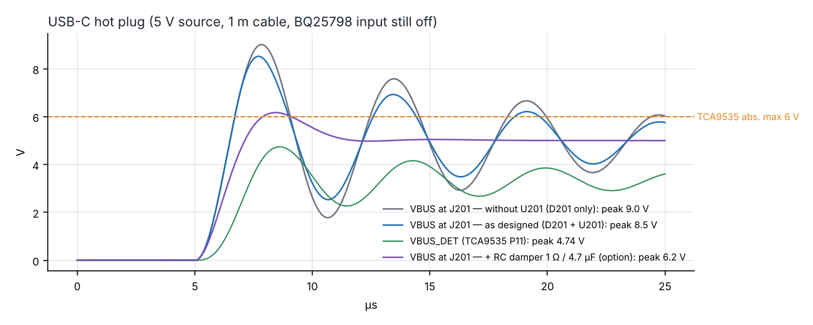<figcaption>S6 — USB-C hot plug</figcaption></figure>

### S7 — I2C edges
Bus capacitance from the routed boards: 298 mm of trace per line (main 244 mm + head 54 mm), 120 mm of head cable,
≈ 15 vias and 7 devices (ESP32-S3, BQ25798, TCA9535 9.5 pF max, LSM6DSOX, 2 × VL53L4CD, VL53L1X) → 111 pF.
2.2 kΩ: 207 ns (limit 300 ns); with 50 % more capacitance 310 ns; 1.5 kΩ
would give 211 ns (3 mA sink limit still met). Measure tr at bring-up.

<figure>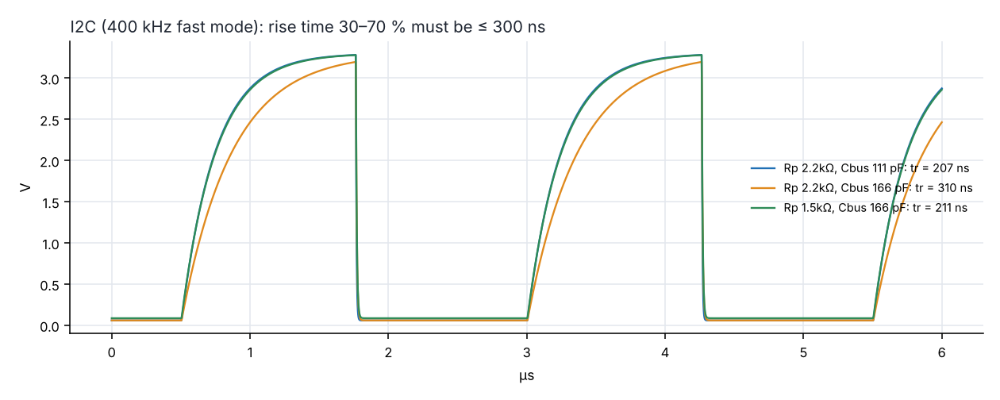<figcaption>S7 — SDA rising edges</figcaption></figure>

### S8 — display SPI over the head cable
33 Ω series (R403) → 48 mm on the main board → 120 mm cable → 73 mm on the head board → module with ESD diodes.
At the default drive strength the edge rings to 3.79 V / -0.49 V (diode current
< 1 mA, harmless but outside the ±0.3 V rating); with drive strength 1 the edge is clean
(3.30 V / 0.00 V). Without R403 it would reach 4.24 V.

<figure>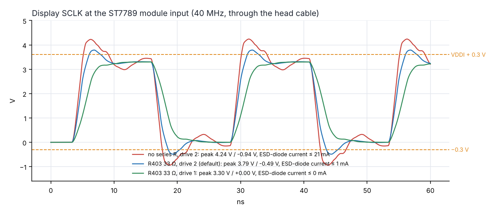<figcaption>S8 — SCLK at the display</figcaption></figure>

## 3. System analyses (Python)

### A — mass properties and stability
Printed parts from the CAD solids (PETG 1.27 g/cm³ × solid fraction), bought parts from catalogue masses at their CAD
positions: **750 g**, CoG (0.5, 3.3, 56.1) mm. Lateral tipping in a turn needs
6.2 m/s² (not a concern); tipping back needs only 0.58 m/s² (see finding 1).

<figure>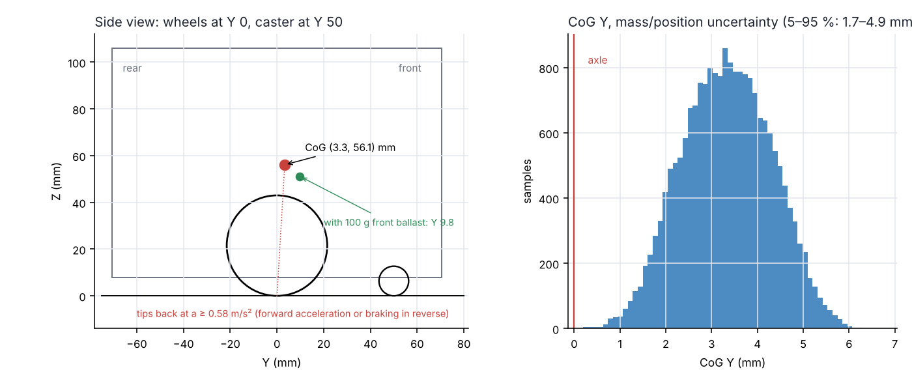<figcaption>A — CoG and its uncertainty</figcaption></figure>

### B — drive
Generic GA12-N20 6 V motor (9 Ω, 15 000 rpm base, est.), gearbox efficiency 0.48–0.65:

| Gear | Wheel rpm (6 V) | Max speed | Stall force (2 motors) | Encoder counts / mm |
|---|---|---|---|---|
| 1:30 | 500 | 1.13 m/s | 4.1 N | 6.2 |
| 1:50 | 300 | 0.68 m/s | 6.5 N | 10.4 |
| 1:100 | 150 | 0.34 m/s | 11.5 N | 20.7 |
| 1:150 | 100 | 0.23 m/s | 16.3 N | 31.1 |
| 1:298 | 50 | 0.11 m/s | 29.9 N | 61.8 |

Recommended **1:100 (150 rpm at 6 V)**: 0.34 m/s top speed, fine control down to ≈ 3 cm/s for docking, 20.7 counts/mm.
A 0.4 m/s² ramp needs only 0.06 A per motor; stall at 8.4 V is 0.84 A (TB6612 1.2 A
continuous). Every option can exceed the tip-back limit, so acceleration must be limited in firmware; keep the motor PWM
at a 6 V average (duty ≤ 6 V / VSYS).

<figure>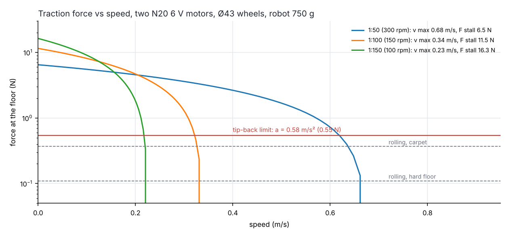<figcaption>B — force vs speed</figcaption></figure>

### C — power budget and runtime
Loads (est., Pi 5 figures from published measurements; camera and XVF3800 powered from the Pi): +5V buck 90–93 %,
+3V3 86 %, pack resistance 67 mΩ, cut-off 3.25 V/cell under load.

| Mode | Battery power | Runtime |
|---|---|---|
| Pi off (standby) | 0.2 W | 273.3 h |
| Idle, listening | 4.3 W | 10.1 h |
| Conversation (cloud AI) | 6.4 W | 6.9 h |
| Vision + driving | 8.9 W | 4.9 h |
| Full load (local AI) | 10.2 W | 4.3 h |

<figure>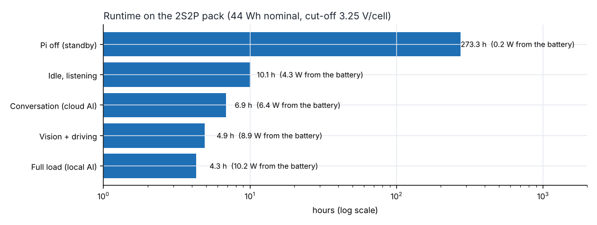<figcaption>C — runtime</figcaption></figure>

### D — charging
BQ25798 with ICHG 3 A, 8.4 V, termination 0.2 A; dock path 12 V − 0.32 Ω × I (cable, PTC, Q1, pogo, input FETs), buck
94 %; USB-C 5 V − 0.14 Ω × I, boost 91 %; battery model with OCV curve, pack resistance and a polarisation branch.

| Case | Input power | 10 → 80 % | Full |
|---|---|---|---|
| Dock, IINDPM 2.5 A, Pi idle | 28.0 W | 1.5 h | 2.6 h |
| Dock, IINDPM 1.8 A, Pi idle | 20.6 W | 2.2 h | 3.3 h |
| Dock, IINDPM 1.8 A, Pi off | 20.6 W | 1.7 h | 2.8 h |
| USB-C 5 V 3 A source, Pi idle | 13.7 W | 4.0 h | 5.4 h |
| USB 5 V 1.5 A source, Pi idle | 7.2 W | — | > 12 h |

<figure>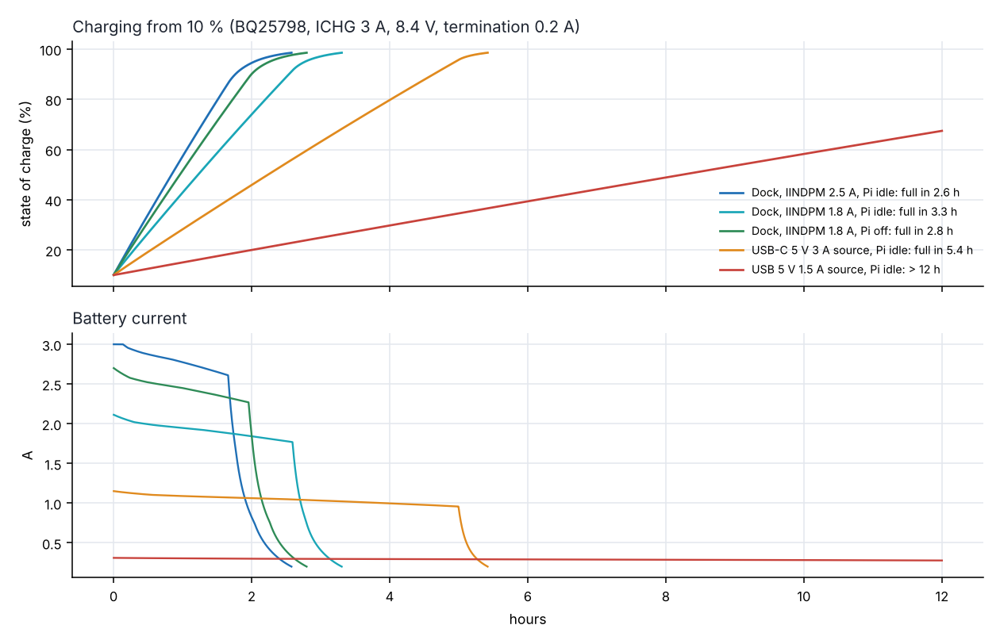<figcaption>D — charging</figcaption></figure>

### E — pogo pins
Contact resistance per pin uniformly 20–100 mΩ (datasheet max 100 mΩ), the worse of the two polarity pairs counts.
Loop drop at 1.8 A ≤ 0.18 V; ≤ 81 mW per contact.

<figure>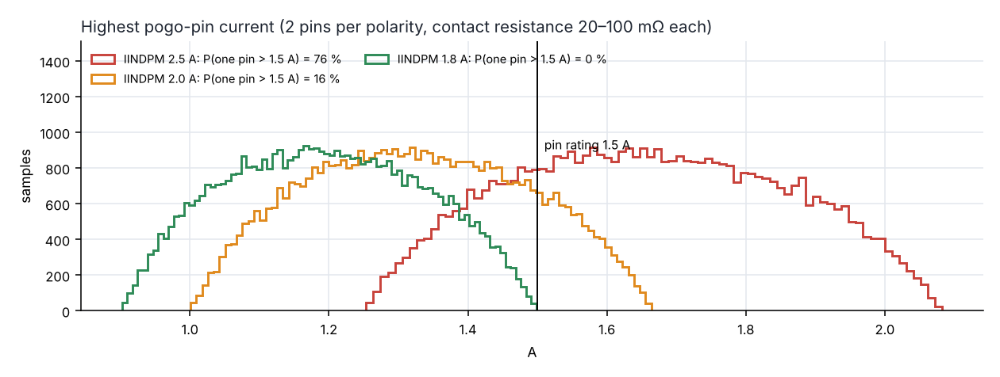<figcaption>E — highest pin current</figcaption></figure>

### F — battery protector and fuse
R5460N212AF: discharge over-current 0.200 V ± 15 mV (12 ms), short circuit 1.1 V (0.7–1.5 V, 300 µs), charge
over-current −0.2 V; 2 × CSD17579Q3A (10.2 mΩ max at 10 V, 14.2 mΩ max at 4.5 V; gate drive ≈ VDD). Trip range
6.4–12.6 A (typ. 10.0 A); short 24–88 A; charge
over-current ≥ 5.9 A vs. ICHG 3 A. Over-charge detection 4.29 V/cell vs. 4.20 V charge: the
pack has no balancing, so use matched cells from one batch.

<figure>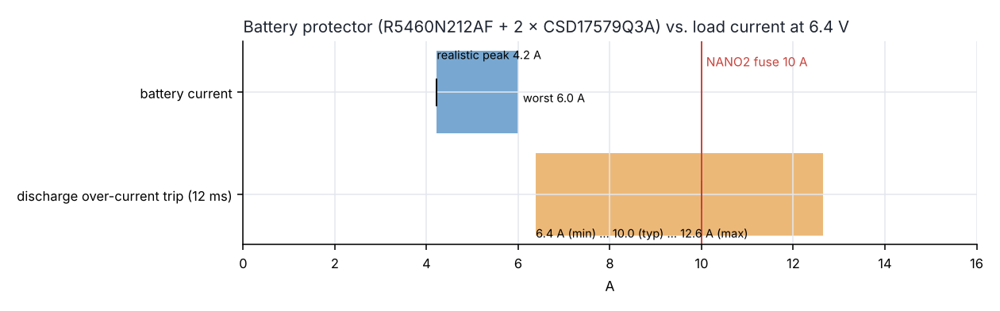<figcaption>F — protector margin</figcaption></figure>

### G — thermal
Lumped model: shell walls ≈ 0.30 W/K, board underside 0.08 W/K, stack-effect flow through the wheel cut-outs and the
gills/halo holes, part of the Active Cooler flow exchanged through the gills; SoC ≈ 8.5 K/W above the cooler intake.

| Case | Internal air | SoC | SoC with more venting |
|---|---|---|---|
| idle @ 25 °C | 33 °C | 49 °C | 47 °C |
| idle @ 35 °C | 43 °C | 59 °C | 57 °C |
| conversation @ 25 °C | 36 °C | 60 °C | 57 °C |
| conversation @ 35 °C | 46 °C | 70 °C | 67 °C |
| full load @ 25 °C | 41 °C | 82 °C | 78 °C |
| full load @ 35 °C | 51 °C | 92 °C | 88 °C |
| docked + charging, idle @ 25 °C | 36 °C | 52 °C | 49 °C |
| docked + charging, idle @ 35 °C | 46 °C | 62 °C | 59 °C |
| docked + charging, full load @ 25 °C | 44 °C | 85 °C | 80 °C |
| docked + charging, full load @ 35 °C | 54 °C | 95 °C | 90 °C |

<figure>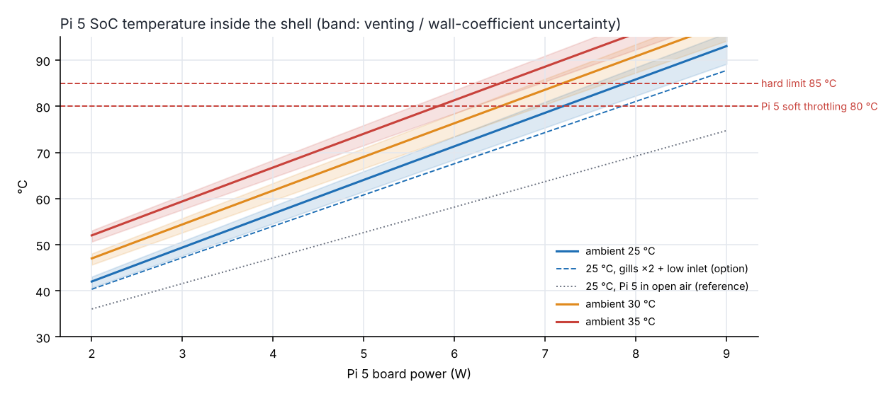<figcaption>G — Pi 5 SoC temperature</figcaption></figure>

### H — docking Monte Carlo (40 000 runs per case)
Error sources: tag pose (lateral and yaw, growing with distance), camera-yaw calibration, the blind drive to the turn
point, gyro scale error over 180°, turn-centre drift, then the reverse. Capture when the rear opening meets the tongue
within ±6.5 mm (2 mm clearance + 4.5 mm chamfer) and ±6°.

| Procedure | First try | σ at the opening | Within 3 tries |
|---|---|---|---|
| A: align at 0.40 m, turn there, reverse 0.40 m | 46 % | 10.8 mm | 83.8 % |
| B: last fix at 0.12 m, turn at 134 mm, reverse 62 mm | 99 % | 2.6 mm | 100.0 % |
| B without gyro/camera calibration | 82 % | 4.9 mm | 99.4 % |
| A with an 8 mm tongue chamfer | 65 % | 10.7 mm | 95.6 % |

<figure>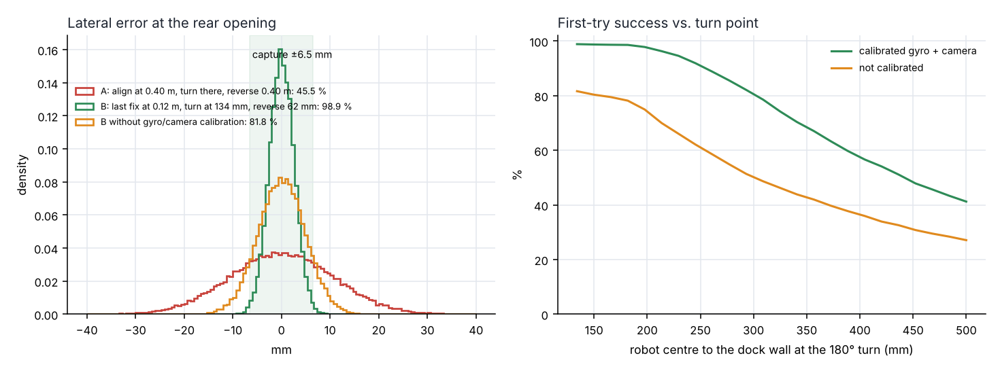<figcaption>H — docking</figcaption></figure>

### I — AprilTag range (Camera Module 3, HFOV 66°)

<figure>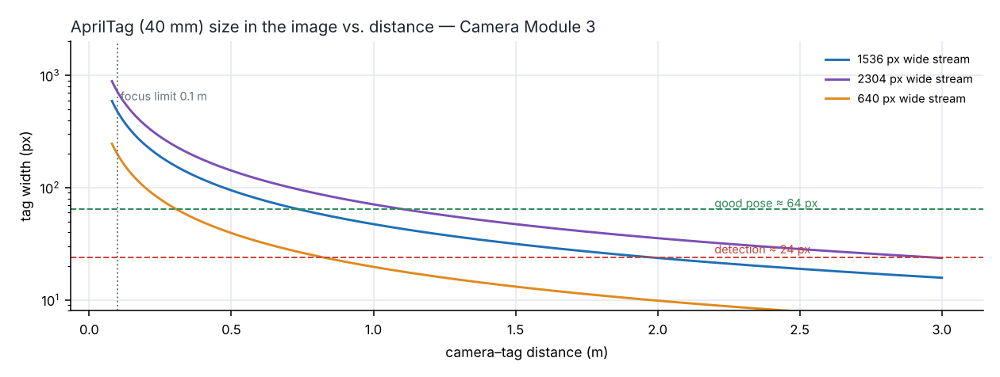<figcaption>I — tag size in the image</figcaption></figure>

## 4. What was not simulated (and how to check it)

| Item | Why | Check at bring-up |
|---|---|---|
| BQ25798 internal loops, power-path hand-over, ICO | no public model | scope VSYS while plugging/unplugging the dock and USB-C under load |
| Wi-Fi / BLE (ESP32-S3 antenna in the shell), Pi 5 Wi-Fi | RF/EM tools and the real enclosure needed | RSSI at 1/5/10 m with the shell on and off |
| EMC / ESD | needs a lab | ESD gun on the dock contacts, USB-C and the touch spot |
| Acoustics (XVF3800 AEC, speaker in the shell) | room and enclosure dependent | XVF3800 tuning tools, echo-return loss with music |
| Board-level thermal (TPS566238, BQ25798 hot spots) | no FEA here | thermal camera at 3 A / 5 A and while charging |
| Printed-part strength, drops | no FEA | 0.5 m drop on the skirt corners |
| Firmware timing (motor loop, PCNT, I2C traffic) | software | logic analyser |

## 5. Files

`sim/spice_sims.py` (S1–S8), `sim/cot.py` (behavioural COT buck), `sim/spice_lib.py` (ngspice runner),
`sim/mass_props.py` (CAD mass properties), `sim/system_sims.py` (A–I), `sim/build_sim_report.py` (this report);
netlists in `sim/spice/`, results in `sim/out/spice_results.json` and `sim/out/system_results.json`.
